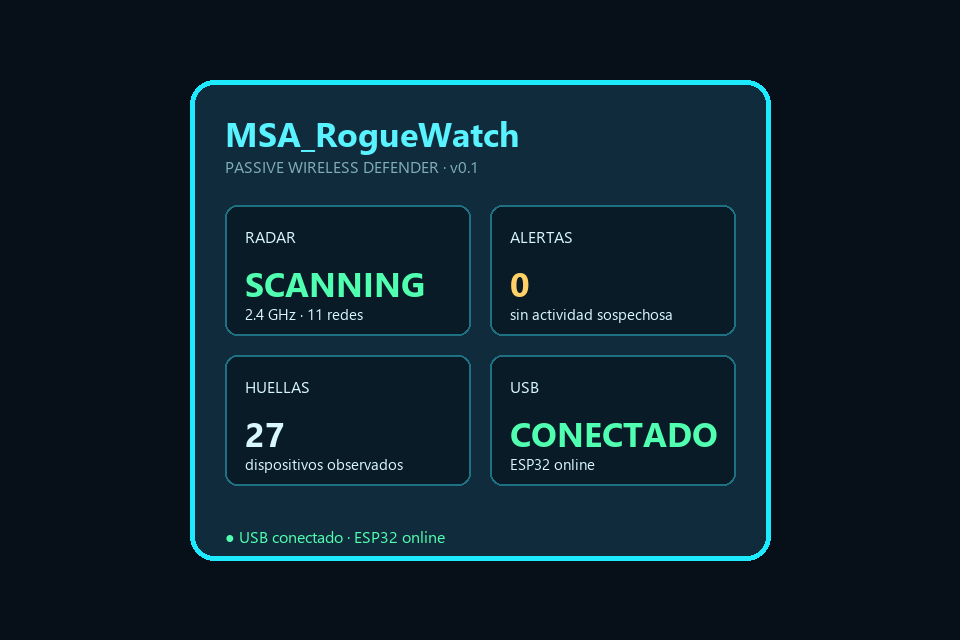

# MSA-RogueWatch

> **MS ROBOTIKA · Prototipo de laboratorio** · [Estado y límites](docs/PROJECT_STATUS.md) · [Evidencias de interfaz](ui/captures/) · [Seguridad](SECURITY.md)

*Vista de demostración de la interfaz. No implica validación de detección sobre hardware ni prueba de intrusión.*

Detector portátil y pasivo de puntos de acceso sospechosos para laboratorios de ciberseguridad. Aprende la huella de una red autorizada y avisa cuando detecta un SSID clonado, un BSSID nuevo o una configuración de seguridad inesperada.

## Qué detecta

- SSID conocido con BSSID no registrado.
- Cambio inesperado de canal o cifrado.
- Múltiples emisores con el mismo nombre.
- Señal anormalmente fuerte o cambiante.
- Redes abiertas que imitan una red protegida.

## Pantallas

`RADAR` · `RED CONFIABLE` · `ALERTAS` · `HUELLAS` · `EVIDENCIAS`

La pantalla parpadea en rojo solo cuando hay una anomalía observada. El dispositivo no se asocia a redes, no inyecta paquetes y no desconecta clientes.

## Estado

Prototipo inicial para ESP32 clásico con pantalla y registro opcional en microSD. La configuración se exporta como JSON para poder revisar las alertas en el PC.

## Uso autorizado

Úsalo únicamente en redes propias o con permiso. Una alerta es un indicio para investigar, no una prueba automática de intrusión.

## Licencia

MIT.

## Vista previa

La maqueta visual de la interfaz está en [ui/index.html](ui/index.html). La placa usa la misma idea de cuatro vistas, controladas con BOOT; consulta [docs/CONTROLS.md](docs/CONTROLS.md).

### Capturas

- [Estado conectado](ui/captures/connected.svg)
- [Estado pausado](ui/captures/paused.svg)

Vistas del ESP: [Radar](ui/captures/radar.svg), [Alertas](ui/captures/alertas.svg), [Huellas](ui/captures/huellas.svg), [Evidencias](ui/captures/evidencias.svg).

### Capturas PNG

- [Radar](ui/captures/radar.png) · [Alertas](ui/captures/alertas.png) · [Huellas](ui/captures/huellas.png) · [Evidencias](ui/captures/evidencias.png)
